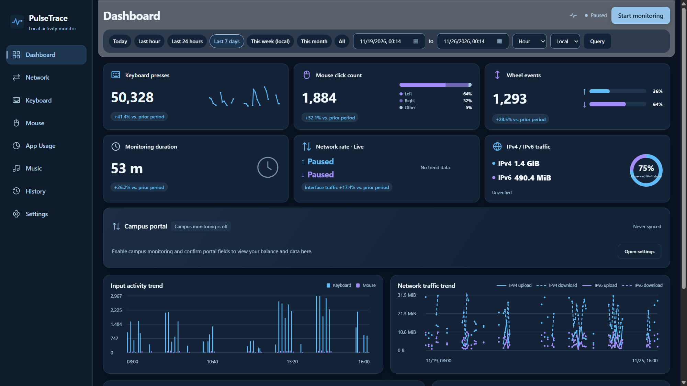
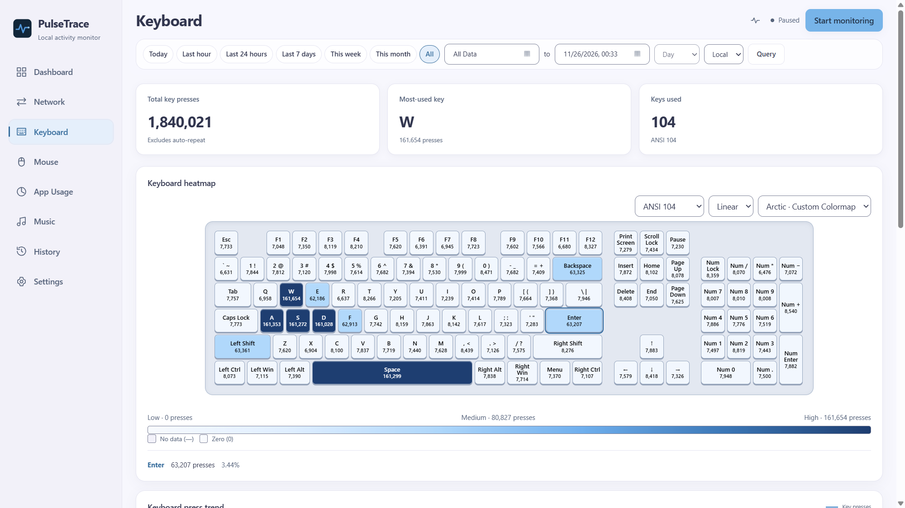
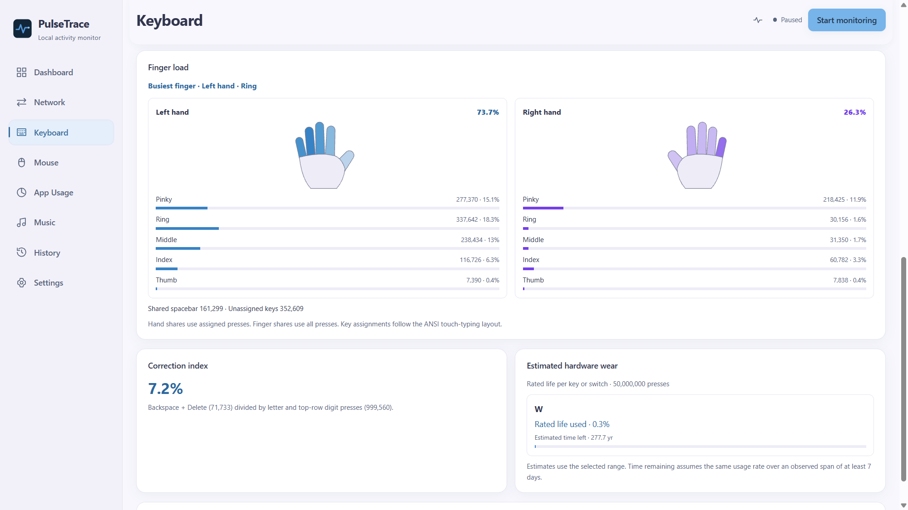
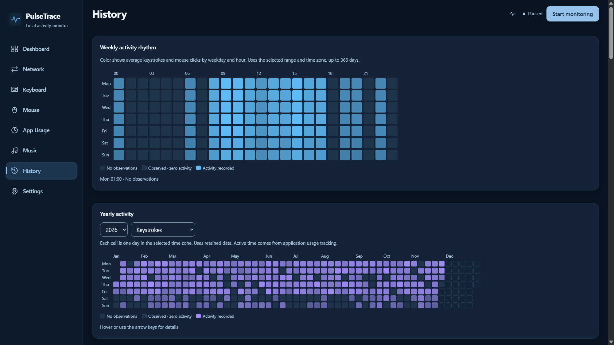
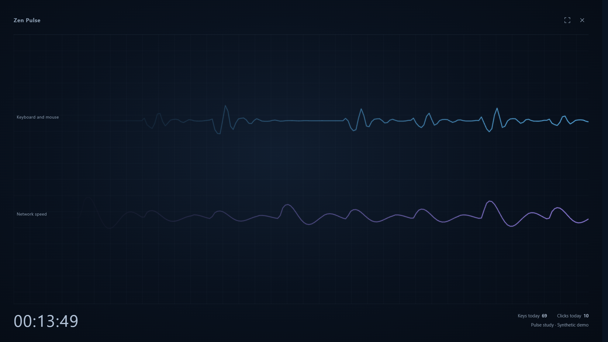
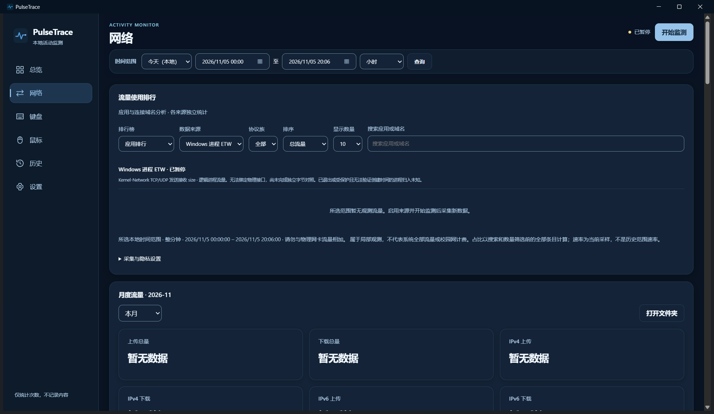
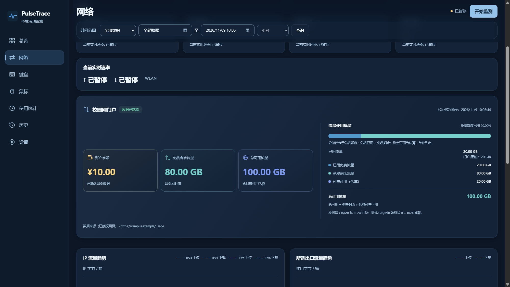
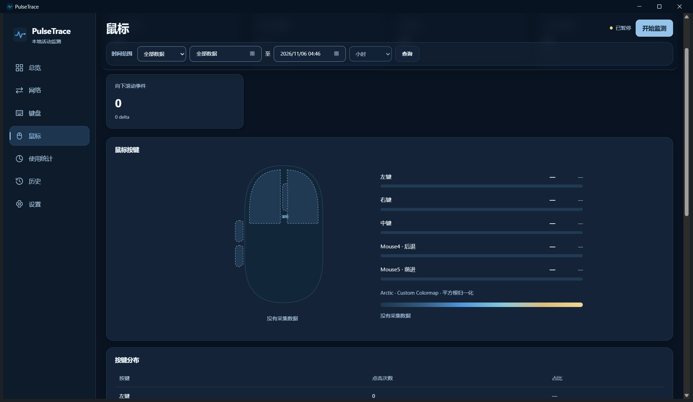
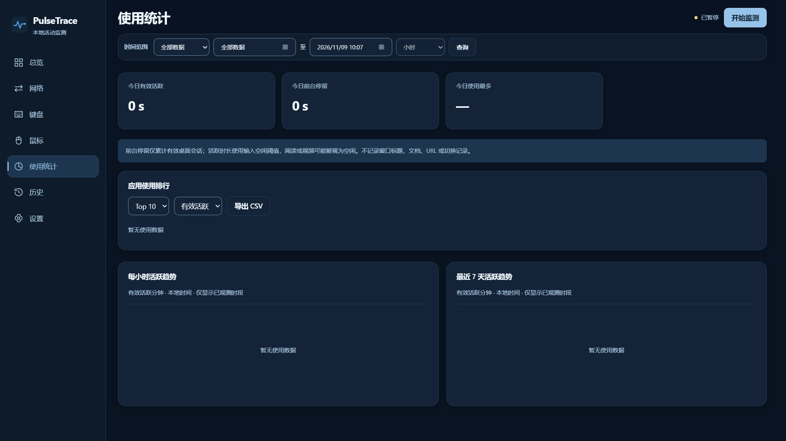

# PulseTrace

面向 Windows 的本地键鼠、应用使用与网络活动统计工具。

**简体中文** · [English](README_EN.md)

## 功能特性

- **键盘与鼠标** · ANSI 104／TKL 热力图、浅色 Arctic、线性／对数色阶、十指负载、纠错比例、滚轮里程、硬件寿命估算与峰值 KPM／APM。
- **活动历史** · 7×24 昼夜节律矩阵、五维年度活动墙、总览环比与本地成就。七个时间快捷项、自定义范围及本地时间／UTC 分桶。
- **应用使用** · 前台停留与有效活跃时长、排行、小时／日期趋势、排除列表及 CSV 导出。
- **音乐与 BGM Buff** · 可选 QQ 音乐／网易云 SMTC 统计。启用后可查看播放排行及按键速率、前台应用关联和单日曲目标记。 [支持范围](docs/music.md)
- **网络与校园网** · 三张双向流量卡、IPv4／IPv6 趋势、月度日历和连接历史。可选校园网监控和低余额／低免费流量 Windows 提醒，默认关闭。 [校园网说明](docs/campus-portal.md)
- **主题与分享** · Deep Ocean／Pearl Mist 可跟随系统。总览可导出内容可选的双主题 PNG，音乐默认不包含。
- **脉冲模式** · 深色双轨显示实时键鼠与网络波动，支持副屏全屏。隐藏或最小化后停止动画。
- **数据与 Windows 集成** · 本地 SQLite、月度归档、备份和 CSV 导出、中英双语、托盘、双源更新检查，以及 Run 或登录计划任务自启。加密 WebDAV 备份需主动启用。 [云备份说明](docs/cloud-backup.md)

首次启动默认暂停。不记录输入文本、窗口标题或鼠标轨迹。活跃时长使用空闲阈值，IPv4／IPv6 观测及排行受权限、采样和质量限制。未签名更新包需校验后手动安装。 [统计边界](docs/traffic-rankings.md) · [应用使用说明](docs/app-usage.md)

## 软件截图

以下为 **v0.9.0 发布准备阶段**的原生 WebView2 截图，使用本周期的 Windows x64 Release 构建。采集已暂停，画面只含合成记录和演示波形。视口为 1600×900 DIP（125% DPI 下为 2000×1125 像素）。

| 深色总览 | 浅色键盘热力图 |
| --- | --- |
|  |  |
| **十指负载** | **昼夜节律与年度活动墙** |
|  |  |

**脉冲模式**

历史截图 · v0.7.4 界面与旧版任务栏

| 网络 | 校园网（合成 Demo） |
| --- | --- |
|  |  |
| **鼠标** | **应用使用** |
|  |  |

## 性能占用

实测 main `d414ecf`：Windows 11 26300、Ryzen 5 5600（12 逻辑核）、31.92 GiB RAM、125% DPI、WebView2 156.0.4314.58。每组 45 秒，取第 10–40 秒均值；启用监测，未主动生成输入或网络负载，排行来源关闭。

| 运行状态 | CPU（整机归一化） | Private Bytes | Working Set |
| --- | ---: | ---: | ---: |
| 后台监测，仅托盘 | 0.039% | 8.54 MiB | 34.69 MiB |
| 主界面打开，含 WebView2 子进程 | 0.111% | 262.10 MiB | 460.99 MiB |
| 后台监测 + 任务栏网速 | 0.022% | 9.20 MiB | 40.37 MiB |

以上均包含原生 helper；任务栏 helper 单独为 **2.81 MiB Private Bytes / 17.55 MiB Working Set**。Private Bytes 是私有提交量；Working Set 是驻留工作集，进程求和会重复计算共享页。短测不代表长期上限或性能提升。

该次测量的安装清单中的程序文件合计 **11.07 MiB**，不含卸载器、系统 Runtime 和 `data`；含卸载器的安装体积未测。45 秒后数据文件：后台/任务栏约 **0.12 MiB**，界面约 **10.73 MiB**，包含 WebView2 缓存；排除测量报告，不是磁盘写入量。[完整口径与实测](docs/performance.md)

## 下载安装

[GitHub v0.9.0](https://github.com/zhangchengxuv/PulseTrace/releases/tag/v0.9.0) · [Gitee 发布页](https://gitee.com/zhangchenxuv/pulse-trace/releases)

Windows 10/11 x64，需要 Microsoft Edge WebView2 Evergreen Runtime。

- **安装版**：运行 `PulseTrace-Setup-*.exe`；数据在安装目录的 `data`，卸载默认保留。
- **便携版**：完整解压 ZIP，保留 Web 资源、DLL 和 helper，运行 `PulseTrace.exe`。

**v0.9.0** 增加输入洞察、活动节律、BGM Buff 和脉冲模式。从 v0.8.0 升级沿用 SQLite schema 9。 [v0.9.0 发布说明](docs/releases/v0.9.0.md) · [使用说明](docs/desktop-guide.md) · [源码构建](docs/build.md)

## 技术栈

C++20 · Win32 / Raw Input · WebView2 · SQLite · CMake

## AI 开发声明与开源协议

PulseTrace 是一个使用 OpenAI Codex 辅助开发的开源项目。主要代码、界面和文档由 OpenAI 模型辅助生成，并经过实际构建与测试。本项目并非 OpenAI 官方产品。

- **AI 工具**：OpenAI Codex。
- **可核实模型**：GPT-6；未确认的历史模型不列出。
- **协议**：自有源码及文档采用 [MIT License](LICENSE)；第三方组件保留各自许可，见 [第三方声明](THIRD-PARTY-NOTICES.md)。TrafficMonitor 仅作机制参考，未移植其代码。
