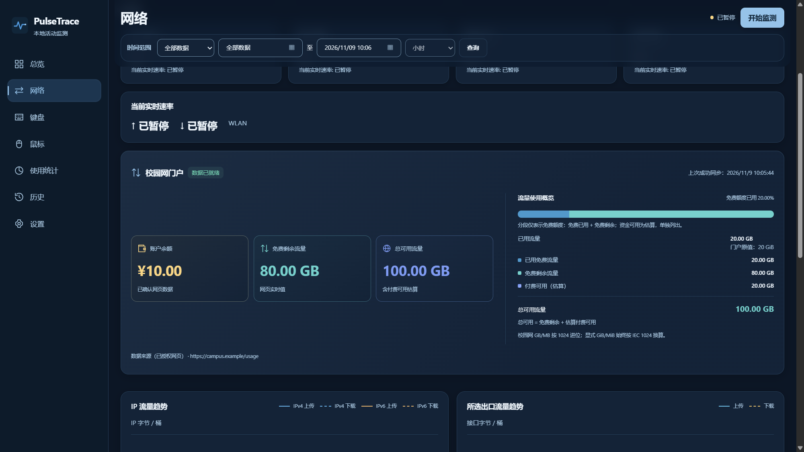

# PulseTrace

面向 Windows 的本地键鼠、应用使用与网络活动统计工具。

**简体中文** · [English](README_EN.md)

## 功能特性

- **键盘**：按键聚合统计、ANSI 104 布局及 Arctic 连续热力图。
- **鼠标**：二维五键热力图与排行，Mouse4 后退、Mouse5 前进；时间双击、滚轮事件与 delta 分开统计。
- **应用使用**：前台停留与有效活跃时长、排行、小时/日期趋势、排除列表及 CSV 导出。
- **音乐（开发版）**：可选 QQ 音乐 / 网易云 SMTC 播放时长、有效次数、歌曲/歌手排行及趋势；默认关闭。[支持范围](docs/music.md)。
- **网络**：出口上传/下载、物理接口 IPv4/IPv6 观测、自然月每日流量热力图、接口与连接历史。
- **校园网**：可选通用门户监控，独立 WebView2 登录、DOM 字段识别与确认、余额/额度/周期快照；默认关闭。
- **页面精简**：网络页移除应用流量排行及其刷新请求，保留原历史；键位使用排名默认收起，展开状态随刷新保留。
- **云备份**：分类设置导航，坚果云 HTTPS WebDAV、DPAPI 凭据保存、强制加密归档及确认恢复。[云备份说明与验证范围](docs/cloud-backup.md)。
- **实时网速**：在总览和网络页显示；已移除任务栏网速组件，保留托盘后台运行。
- **历史与设置**：默认全部数据、分钟/小时/天及自定义范围，SQLite、月度归档、备份与导出；中英双语、Deep Ocean / Pearl Mist、托盘后台及双源更新检查。

首次启动默认暂停，不记录输入文本、窗口标题或鼠标轨迹。活跃时长使用空闲阈值；IPv4/IPv6 与排行受权限、采样及质量限制，不代表全系统流量或校园网计费。校园网监控默认关闭，无法确认的门户字段保持未知。未签名更新包只支持校验后手动安装。[统计边界](docs/traffic-rankings.md) · [应用使用说明](docs/app-usage.md) · [校园网说明](docs/campus-portal.md)

## 软件截图

真实 **v0.7.4 x64 Release** 界面，使用独立空数据目录并暂停采集。页面统一为 1600×900 DIP（125% DPI 下 2000×1125 像素）。校园网 **Demo** 使用内存合成读数，不含个人账号或统计。v0.7.6 已包含文案精简与鼠标图形更新；此处保留 v0.7.4 截图。

| 总览 | 网络 |
| --- | --- |
|  |  |
| **ANSI 104 键盘热力图** | **校园网门户 · Demo** |
|  |  |

鼠标与应用使用统计

| 鼠标 | 应用使用 |
| --- | --- |
|  |  |

历史任务栏组件（v0.7.1 已移除）

## 性能占用

实测 main `d414ecf`：Windows 11 26300、Ryzen 5 5600（12 逻辑核）、31.92 GiB RAM、125% DPI、WebView2 156.0.4314.58。每组 45 秒，取第 10–40 秒均值；启用监测，未主动生成输入或网络负载，排行来源关闭。

| 运行状态 | CPU（整机归一化） | Private Bytes | Working Set |
| --- | ---: | ---: | ---: |
| 后台监测，仅托盘 | 0.039% | 8.54 MiB | 34.69 MiB |
| 主界面打开，含 WebView2 子进程 | 0.111% | 262.10 MiB | 460.99 MiB |
| 后台监测 + 任务栏网速 | 0.022% | 9.20 MiB | 40.37 MiB |

以上均包含原生 helper；任务栏 helper 单独为 **2.81 MiB Private Bytes / 17.55 MiB Working Set**。Private Bytes 是私有提交量；Working Set 是驻留工作集，进程求和会重复计算共享页。短测不代表长期上限或性能提升。

当前安装清单中的程序文件合计 **11.07 MiB**，不含卸载器、系统 Runtime 和 `data`；含卸载器的当前安装体积待测。45 秒后数据文件：后台/任务栏约 **0.12 MiB**，界面约 **10.73 MiB**，包含 WebView2 缓存；排除测量报告，不是磁盘写入量。[完整口径与实测](docs/performance.md)

## 下载安装

[GitHub v0.7.6](https://github.com/zhangchengxuv/PulseTrace/releases/tag/v0.7.6) · [Gitee v0.7.6](https://gitee.com/zhangchenxuv/pulse-trace/releases/tag/v0.7.6)

Windows 10/11 x64，需要 Microsoft Edge WebView2 Evergreen Runtime。

- **安装版**：运行 `PulseTrace-Setup-*.exe`；数据在安装目录的 `data`，卸载默认保留。
- **便携版**：完整解压 ZIP，保留 Web 资源、DLL 和 helper，运行 `PulseTrace.exe`。

版本 **v0.7.6** 修复更新检查限流与错误提示，保留统计、数据和配置。验证范围见[发布说明](docs/releases/v0.7.6.md)。[使用说明](docs/desktop-guide.md) · [源码构建](docs/build.md)

## 技术栈

C++20 · Win32 / Raw Input · WebView2 · SQLite · CMake

## AI 开发声明与开源协议

PulseTrace 是一个使用 OpenAI Codex 辅助开发的开源项目。主要代码、界面和文档由 OpenAI 模型辅助生成，并经过实际构建与测试。本项目并非 OpenAI 官方产品。

- **AI 工具**：OpenAI Codex。
- **可核实模型**：GPT-6；未确认的历史模型不列出。
- **协议**：自有源码及文档采用 [MIT License](LICENSE)；第三方组件保留各自许可，见 [第三方声明](THIRD-PARTY-NOTICES.md)。TrafficMonitor 仅作机制参考，未移植其代码。
