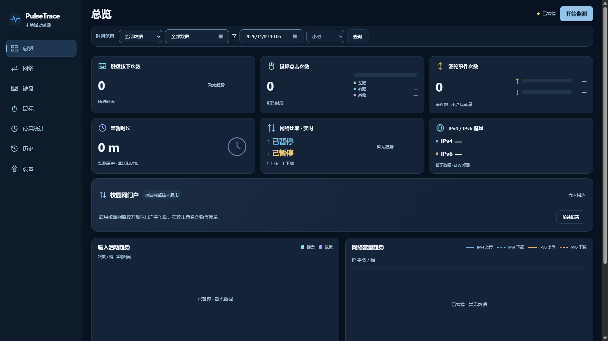
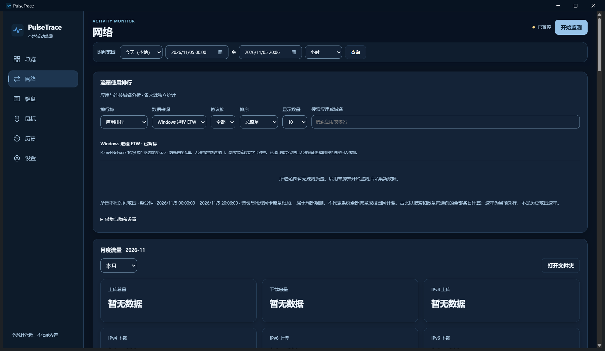
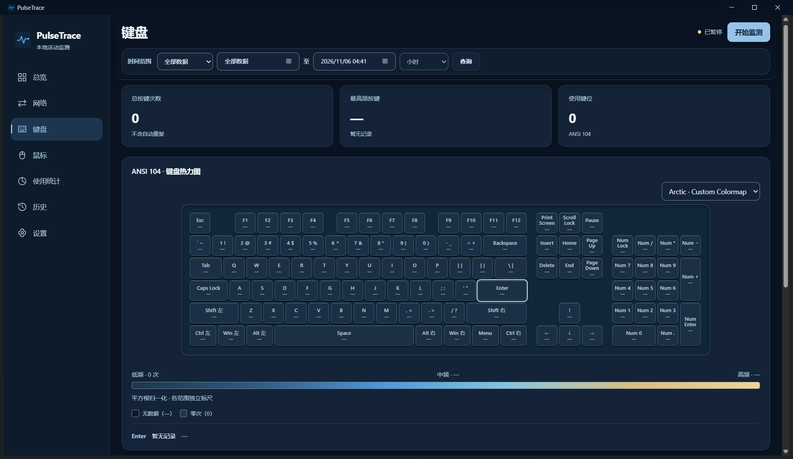

# PulseTrace

A local keyboard, mouse and network activity monitor for Windows.

[简体中文](README.md) · **English**

## Features

- **Keyboard**: key counts, frequency and an ANSI 104 heatmap; aggregate counts only.
- **Mouse**: five buttons, temporal double clicks, vertical/horizontal wheel events and cumulative deltas.
- **App Usage**: foreground dwell and active time, rankings, hourly/daily trends, exclusions and CSV; [measurement details](docs/app-usage.md).
- **Network**: interface status, switching history, upload/download rates and physical-interface IPv4/IPv6 traffic observations.
- **Traffic rankings**: optional Mihomo application/connection-domain rankings with IP-family, time-range, search and sorting controls; domain history requires separate consent.
- **Taskbar speed**: a native Windows 11 component with transparent background and two-line upload/download display; floating-window or tray fallback.
- **History**: minute/hour/day and custom ranges, SQLite persistence, monthly network archives, export and backup.

Chinese/English, light/dark themes and tray background operation are supported. Collection starts paused. Input text and mouse trajectories are not recorded. IPv4/IPv6 observations and rankings depend on permissions, sampling and data quality; they do not represent complete system traffic or campus billing. See [measurement limits](docs/traffic-rankings.md).

## Screenshots

Real Release builds using isolated empty data directories and paused collection; no fabricated statistics or personal records. Page captures use 1600×900 DIP; the taskbar image is a native-size detail.

| Dashboard | Network and rankings |
| --- | --- |
|  |  |
| **ANSI 104 keyboard heatmap** | **Taskbar component (paused)** |
|  |  |

## Resource usage

Measured on 2026-11-05: Windows 11 26300, Ryzen 5 5600 (12 logical processors), 31.92 GiB RAM, WebView2 156.0.4314.58. The x64 Release build is from main `14f4f1f`, with monitoring enabled, no deliberate input/network load, and ranking sources disabled. Each state ran for 45 seconds; values are means over seconds 10–40.

| State | CPU (machine-normalized) | Private Bytes | Working Set |
| --- | ---: | ---: | ---: |
| Background monitoring, tray only | 0.031% | 8.30 MiB | 34.58 MiB |
| Main window open, including WebView2 children | 0.095% | 261.07 MiB | 456.77 MiB |
| Background monitoring + taskbar speed | 0.049% | 9.38 MiB | 40.47 MiB |

The taskbar component process alone averaged **2.81 MiB Private Bytes / 17.73 MiB Working Set**; no CPU-time increment was resolved during this short run. Tray-only mode also retains the helper, so its process memory is not the difference between the two totals. Private Bytes measures private committed memory; Working Set measures resident pages, with shared pages counted repeatedly when processes are summed.

Actually installed program files occupied **17.39 MiB**, including the uninstaller but excluding the system WebView2 Runtime and `data`. After 45 seconds, the data directory used about **0.10 MiB** in background mode and **10.72 MiB** after first opening the UI, mostly WebView2 cache. These are file-size sums, not physical write volume or a long-term growth forecast. See [methodology and full results](docs/performance.md).

## Download and install

[GitHub Releases](https://github.com/zhangchengxuv/PulseTrace/releases) · [Gitee Releases](https://gitee.com/zhangchenxuv/pulse-trace/releases)

Windows 10/11 x64 with Microsoft Edge WebView2 Evergreen Runtime is required.

- **Installer**: run `PulseTrace-Setup-*.exe` and choose a location. Data lives in its `data` subdirectory and is retained by default on uninstall.
- **Portable**: extract the complete ZIP and launch `PulseTrace.exe`, keeping the Web resources, DLL and helpers together.

Candidate **v0.3.0-rc3** is available with matching assets on both sources. Main may be ahead of published packages; screenshots and measurements describe the development build above. [User guide](docs/desktop-guide.md) · [Build from source](docs/build.md).

## Technology

C++20 · Win32 / Raw Input · WebView2 · SQLite · CMake

## AI development disclosure and license

PulseTrace is an open-source project developed with the assistance of OpenAI Codex. Its code, interface, and documentation were created with AI assistance and validated through builds and testing. This is not an official OpenAI product.

- **AI tool**: OpenAI Codex.
- **Confirmed model**: GPT-6. There is no complete model inventory for historical sessions; unverified models are not listed.
- **License**: PulseTrace-owned source and documentation use the [MIT License](LICENSE). Third-party components retain their own licenses; see [third-party notices](THIRD-PARTY-NOTICES.md). TrafficMonitor was consulted for taskbar concepts, without porting its code.
