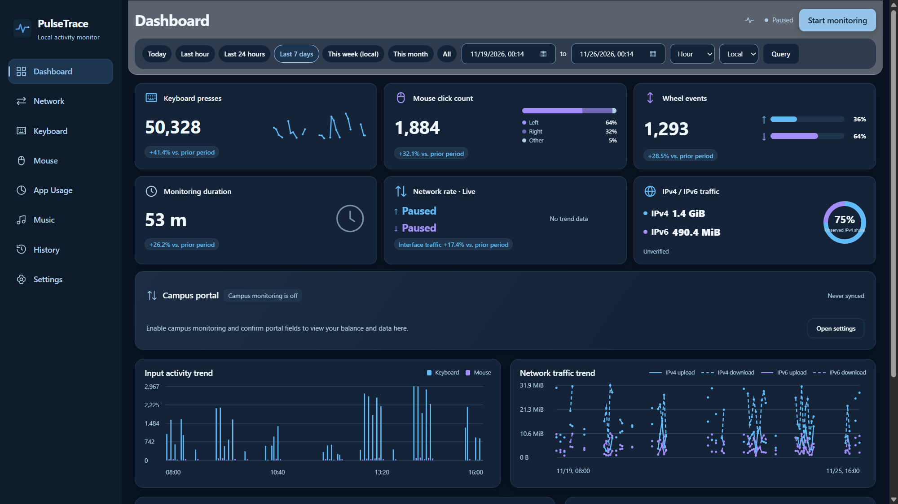
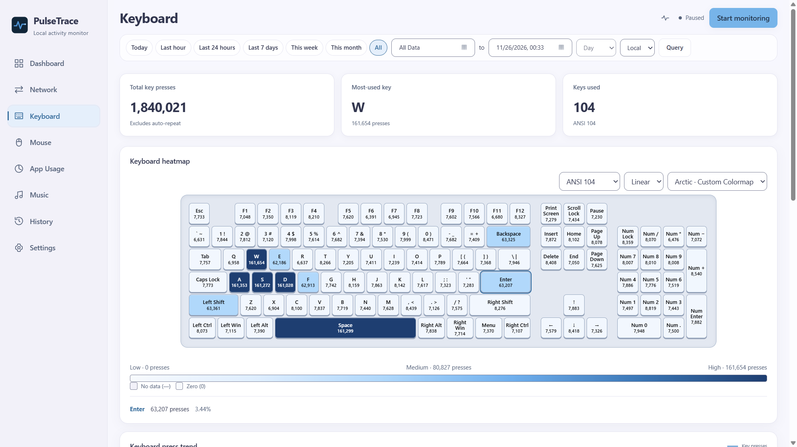
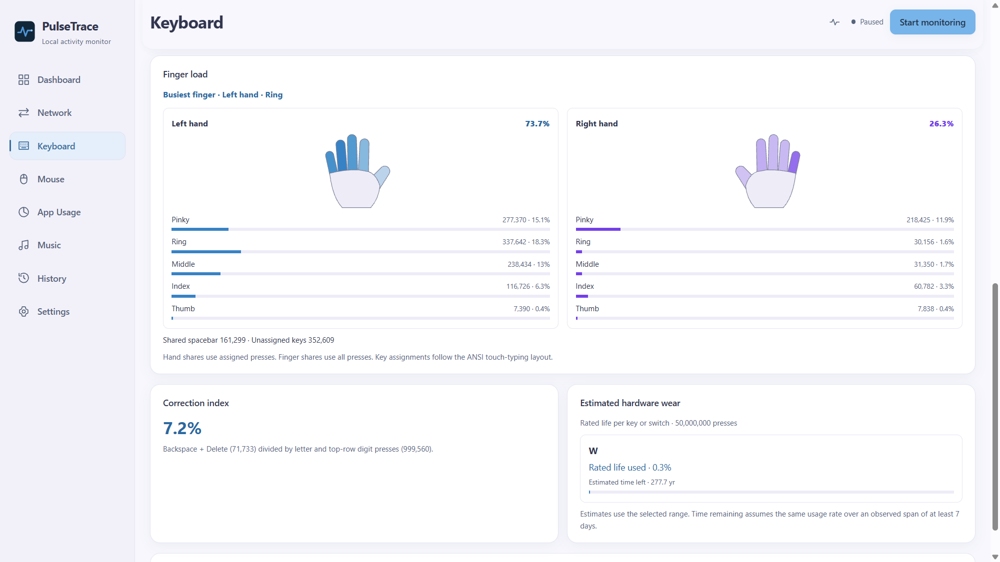
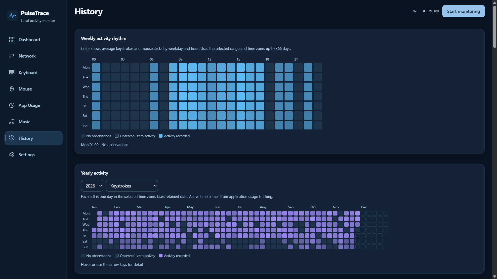
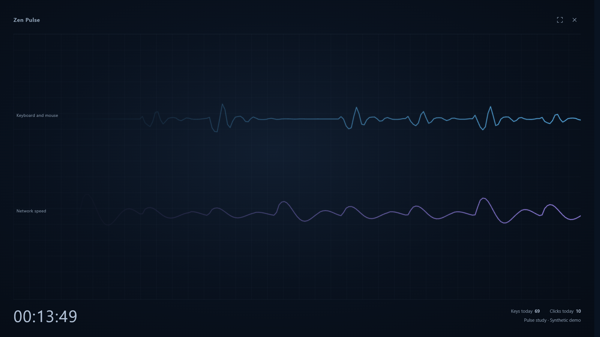
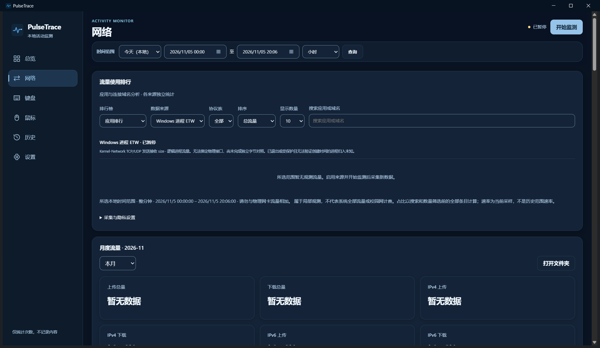
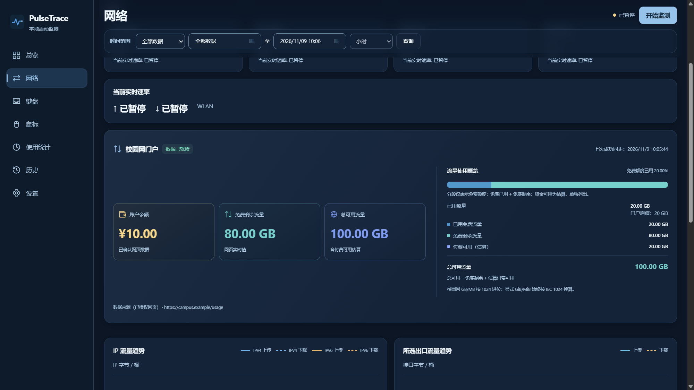
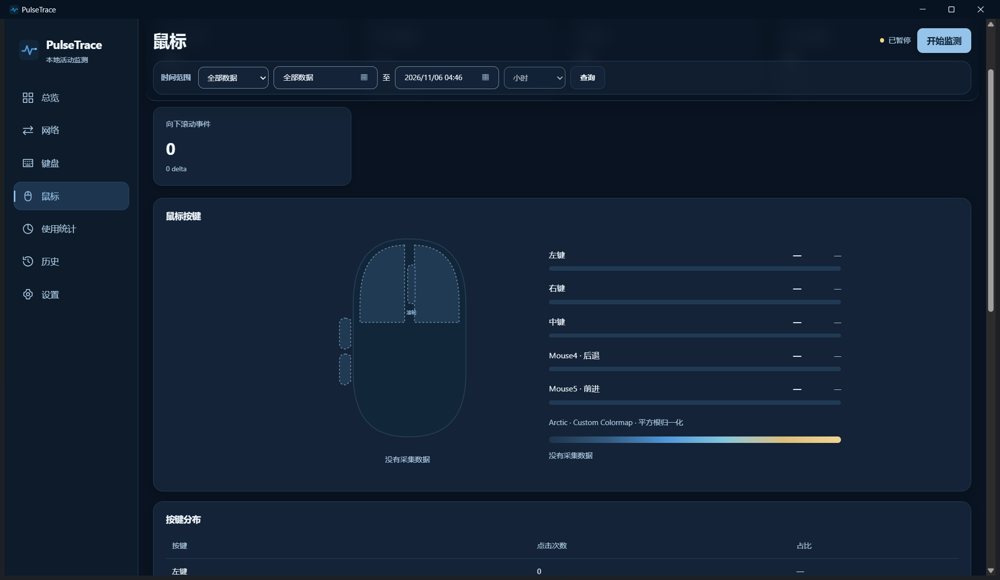
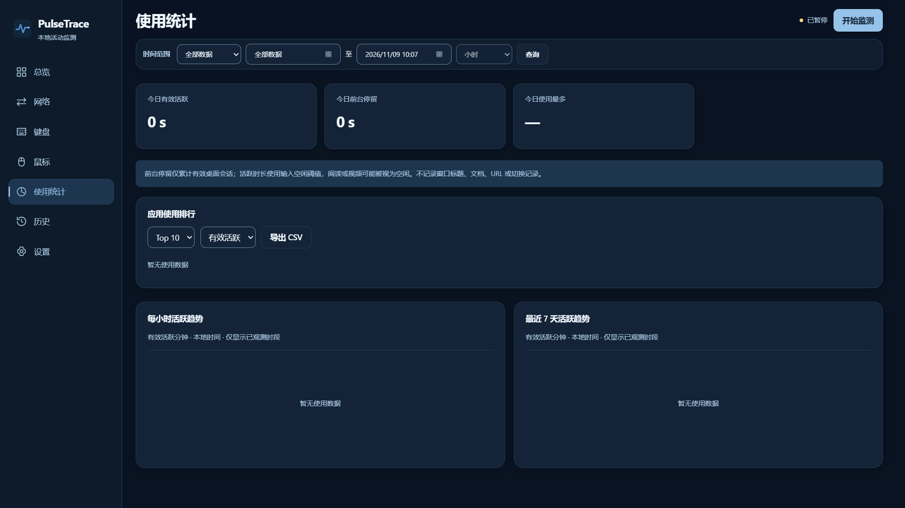

# PulseTrace

A local keyboard, mouse, application usage and network activity monitor for Windows.

[简体中文](README.md) · **English**

## Features

- **Keyboard and mouse** · ANSI 104 and TKL heatmaps, light Arctic, linear/log scales, ten-finger load, correction ratio, wheel distance, lifetime estimates and peak KPM/APM.
- **Activity history** · A 7×24 rhythm matrix, five-metric annual grid, Dashboard period comparisons and local achievements. Seven time shortcuts, custom ranges and local/UTC buckets.
- **App Usage** · Foreground dwell, active time, rankings, hourly and daily trends, exclusions and CSV export.
- **Music and BGM Buff** · Optional QQ Music and NetEase SMTC statistics. View playback rankings, typing rates, foreground app associations and single-day track markers when enabled. [Support limits](docs/music.md)
- **Network and campus portal** · Three bidirectional cards, IPv4/IPv6 trends, monthly calendars and connection history. Optional campus monitoring and Windows alerts for low balance or free data are off by default. [Campus portal guide](docs/campus-portal.md)
- **Themes and sharing** · Deep Ocean and Pearl Mist can follow Windows. Export light or dark Dashboard summary PNGs with selectable contents. Music is unchecked by default.
- **Zen Pulse** · Dark dual traces for live input and network activity, with fullscreen on the current monitor. Animation stops when hidden or minimized.
- **Data and Windows integration** · Local SQLite, monthly archives, backup and CSV export, Chinese/English, tray operation, dual-source update checks and Run or logon-task startup. Encrypted WebDAV backup is opt-in. [Cloud backup guide](docs/cloud-backup.md)

Collection starts paused. Input text, window titles and mouse trajectories are not recorded. Active time uses an idle threshold. IPv4/IPv6 observations and rankings depend on permissions, sampling and data quality. Unsigned update packages require manual installation after verification. [Measurement limits](docs/traffic-rankings.md) · [App Usage](docs/app-usage.md)

## Screenshots

These native WebView2 screenshots are from the **v0.9.0 preparation** build, based on commit `b386c96` in Windows x64 Release configuration. Collection was paused. The screens use synthetic records and demonstration waveforms. The viewport is 1600×900 DIP (2000×1125 pixels at 125% DPI).

| Dark Dashboard | Light keyboard heatmap |
| --- | --- |
|  |  |
| **Ten-finger load** | **Activity rhythm and annual grid** |
|  |  |

**Zen Pulse**

Historical screenshots · v0.7.4 and the former taskbar widget

| Network | Campus portal (synthetic Demo) |
| --- | --- |
|  |  |
| **Mouse** | **App Usage** |
|  |  |

## Resource Usage

Measured main `d414ecf`: Windows 11 26300, Ryzen 5 5600 (12 logical processors), 31.92 GiB RAM, 125% DPI, WebView2 156.0.4314.58. Each run lasted 45 seconds; means use seconds 10–40, with monitoring enabled, no deliberate input/network load and ranking sources disabled.

| State | CPU (machine normalized) | Private Bytes | Working Set |
| --- | ---: | ---: | ---: |
| Background monitoring, tray only | 0.039% | 8.54 MiB | 34.69 MiB |
| Main window open, including WebView2 children | 0.111% | 262.10 MiB | 460.99 MiB |
| Background monitoring + taskbar speed | 0.022% | 9.20 MiB | 40.37 MiB |

All rows include the native helper; the taskbar helper alone used **2.81 MiB Private Bytes / 17.55 MiB Working Set**. Private Bytes measures private committed memory; Working Set measures resident pages, and summing processes double-counts shared pages. These short runs establish neither long-term limits nor performance improvements.

Program files listed by the installer used in that measurement total **11.07 MiB**, excluding the uninstaller, system Runtime and `data`; the installed size including the uninstaller was not measured. After 45 seconds, data files totaled approximately **0.12 MiB** for background/taskbar and **10.73 MiB** with the window open, including WebView2 cache. Measurement reports are excluded; file sizes are not disk writes. [Methods and results](docs/performance.md)

## Download and Install

[GitHub v0.9.0](https://github.com/zhangchengxuv/PulseTrace/releases/tag/v0.9.0) · [Gitee releases](https://gitee.com/zhangchenxuv/pulse-trace/releases)

Windows 10/11 x64 with Microsoft Edge WebView2 Evergreen Runtime is required.

- **Installer**: run `PulseTrace-Setup-*.exe`; data lives in the installation's `data` folder and is retained by default on uninstall.
- **Portable**: extract the complete ZIP, retain Web assets, DLLs and helper, then run `PulseTrace.exe`.

**v0.9.0** adds input insights, activity rhythms, BGM Buff and Zen Pulse. Upgrading from v0.8.0 keeps SQLite schema 9. [v0.9.0 release notes](docs/releases/v0.9.0.md) · [User guide](docs/desktop-guide.md) · [Build from source](docs/build.md)

## Stack

C++20 · Win32 / Raw Input · WebView2 · SQLite · CMake

## AI Development and License

PulseTrace is an open-source project developed with the assistance of OpenAI Codex. Its code, interface, and documentation were created with AI assistance and validated through builds and testing. This is not an official OpenAI product.

- **AI tool**: OpenAI Codex.
- **Verified model**: GPT-6; unconfirmed historical models are omitted.
- **License**: project-owned code and documentation use the [MIT License](LICENSE). Dependencies retain their own licenses; see [third-party notices](THIRD-PARTY-NOTICES.md). TrafficMonitor was consulted for concepts; its code was not ported.
