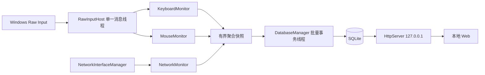

# 技术可行性与总体架构

本设计覆盖原始需求与 MouseMonitor 增补。实现范围目前限于鼠标最小验证。没有现有代码可检查，因此以下 KeyboardMonitor、NetworkMonitor、SQLite、HTTP、Web 都是后续模块设计，不能视为已集成。

## 输入 API 选择

| 方案 | 全局个人统计 | 输入影响与开销 | 决策 |
| --- | --- | --- | --- |
| Raw Input / `RegisterRawInputDevices` / `WM_INPUT` | 当前交互会话/桌面的后台输入；设备粒度有限 | 消息驱动，无需阻塞其他应用；按包处理开销仍须实测 | 首选 |
| 普通 `WM_*BUTTON` / `WM_MOUSEWHEEL` | 主要面向本窗口，不能代替全局监测 | 可收到系统解释后的消息，可能与 Raw Input 重复 | 不并入全局计数 |
| `GetAsyncKeyState` 等轮询 | 无法可靠重建快速变化和滚轮 | 高频轮询浪费 CPU，可能漏过状态变化 | 不使用 |
| `WH_MOUSE_LL` / `WH_KEYBOARD_LL` | 有注入标志等额外信息 | 回调链、超时、性能与权限复杂度 | 不使用；新增 Hook 需另行解释并取得用户确认 |
| 触控板 Pointer / Direct Manipulation | 面向支持该输入的目标窗口 | 不等价于后台全局鼠标流 | 只作为未来局部诊断候选 |

Raw Input 注册由一个 `RawInputHost` 统一负责。进程内每种输入设备类只能注册一个接收窗口，模块自行重复注册会覆盖宿主注册，因此 KeyboardMonitor 和 MouseMonitor 只消费宿主分发的数据。此限制来自 [RegisterRawInputDevices 文档](https://learn.microsoft.com/en-us/windows/win32/api/winuser/nf-winuser-registerrawinputdevices)。

最小程序采用普通 `GetMessage` 阻塞消息循环，注册 `RIDEV_INPUTSINK | RIDEV_DEVNOTIFY`，不设置 `RIDEV_NOLEGACY`、`RIDEV_CAPTUREMOUSE`，不更改输入设置。读完 `WM_INPUT` 后调用 `DefWindowProc` 完成必要清理，依据 [WM_INPUT 文档](https://learn.microsoft.com/en-us/windows/win32/inputdev/wm-input)。每包采用固定大小栈缓冲；只注册鼠标和可选键盘，不处理可变长度 HID 报告。

若 1/4/8 kHz 硬件压力测试暴露消息积压，再研究 `GetRawInputBuffer`：必须先读取当前 `WM_INPUT` 的句柄，再读取队列余项，避免遗漏当前消息或双算；批量读取缺乏每包消息时间时还要重新审视双击时间依据。当前不贸然引入该优化，参考 [Raw Input Overview](https://learn.microsoft.com/en-us/windows/win32/inputdev/about-raw-input)。

### 统计与隐私

点击定义为 DOWN 边沿，按键释放仅供内存内状态机使用；双击计入第二个 DOWN 的分钟。独立按键/设备分别配对，不跨来源、不重叠。单设备五键状态保存在 64 槽固定表；满表不会丢弃点击或滚轮计数，但该设备无法去重和识别双击，并增加诊断计数。设备移除、重连、设置变化、时间/电源通知会清理相关状态。

Windows 标准双击同时要求时间和空间条件。不能读取坐标时，本程序只提供时间双击指标，无法保证与应用动作一致。详见 [Mouse Input Overview](https://learn.microsoft.com/en-us/windows/win32/inputdev/about-mouse-input)。

滚轮 `usButtonData` 按有符号 short 解码；正负事件分别计数、原始整数 delta 分别累加，展示时才除以 120，不做逐事件取整，也不把事件次数当刻度数。它不等于滚动像素、行数或页面数，应用设置及惯性滚动会影响显示行为。依据 [RAWMOUSE](https://learn.microsoft.com/en-us/windows/win32/api/winuser/ns-winuser-rawmouse)。

系统 Raw Input 包不可避免地包含移动字段；适配器不读取这些字段，不将其传给 MouseMonitor，使用后清零临时结构。聚合模块的类型根本不含坐标、运动量或用户内容。只有最近点击的单调时钟值用于双击状态，不序列化；不保留事件队列。报告只含分钟计数、会话总量和性能直方图。

### 输入来源边界

| 观察证据 | 当前分类 | 可以说明什么 | 不能说明什么 |
| --- | --- | --- | --- |
| `RAWINPUTHEADER.hDevice != nullptr` | `device_reported` | 有设备句柄，可用于本次会话内部隔离 | 不能证明是物理鼠标；虚拟 HID、远程会话、触控板兼容层可能看似鼠标 |
| `hDevice == nullptr` | `no_device` | 无法获得可靠的设备身份 | 不能直接标为触控板或合成输入，也不进行跨包双击匹配 |
| 接口明确报告 injected / touchpad | 预留 `injected_reported` / `touchpad_reported` | 只代表接口报告的证据 | 当前 Raw Input 适配器并未实现可靠赋值；零值不代表没有该类活动 |
| 无可靠证据 | `unknown` | 明确表达不可识别 | 不能计入“已验证物理输入” |

微软明确指出 precision touchpad 的 Raw Input 设备句柄可以为零，见 [RAWINPUTHEADER](https://learn.microsoft.com/en-us/windows/win32/api/winuser/ns-winuser-rawinputheader)。触控板手势也可能经系统转成滚轮消息，Raw Input 不保证能获得全部手势，见 [Precision Touchpad Input](https://learn.microsoft.com/en-us/windows/win32/input-precisiontouchpad/precision-touchpad-portal)。

`GetCurrentInputMessageSource` 可给适用的窗口输入消息提供来源信息，但不能在缺少保证的情况下当作 Raw Input 的全局可信来源证明，也不能可靠地与另一路消息逐包配对。甚至 `IMO_HARDWARE` 也可包含 UIAccess 应用注入的输入，见 [INPUT_MESSAGE_ORIGIN_ID](https://learn.microsoft.com/en-us/windows/win32/api/winuser/ne-winuser-input_message_origin_id)。本阶段不通过 Hook 补齐分类、不主动注入输入、不静默丢弃未知来源。

### KeyboardMonitor 边界

Raw Input 可用于当前桌面中按键频率的事件驱动统计，但不承诺跨安全桌面、锁屏、其他用户会话、所有远程/虚拟设备或全部合成输入。未来键盘模块只按物理键/扫描码和分钟计数；不转换文字，不保存事件顺序、逐键时间、窗口文本或剪贴板。系统没有能可靠辨认所有密码输入的通用信号，因而应默认明确启用、提供暂停和敏感场景排除配置；不能宣称所有密码场景都自动排除。

当前 `--keyboard-count` 仅在共享消息线程内统计键盘总 DOWN 数，用于性能验证；没有实现生产键盘统计、按键热力图或密码上下文排除。

## 网络方案与 Clash TUN

| API / 机制 | 能直接提供的计量 | IPv4/IPv6 分离 | 进程归因 | 权限/驱动与取舍 |
| --- | --- | --- | --- | --- |
| `GetIfTable2` / `GetIfEntry2` | 单接口收发 octet 累计计数 | 否 | 否 | 通常普通用户可读，无新增驱动；适合低频总量/速率采样 |
| `GetAdaptersAddresses`、接口变化通知 | 接口、地址、配置变化 | 可辨地址族，但不是分族流量 | 否 | 元数据与事件管理，不当作计量器 |
| 系统网络性能计数器 | 实例相关的接口/协议统计 | 取决于对象，不能自动变成指定物理出口的精确分族计量 | 有限 | 需核实对象和口径；不是核心精确计费依据 |
| ETW TCP/IP 等协议栈事件 | provider、事件版本和层次相关的传输信息 | 可按事件族区分，但覆盖/长度须验证 | 部分事件可带 PID | 会话权限与丢事件风险，通常需提升权限；不等同网卡线速统计 |
| 内置 NDIS/网络包跟踪 | 选定观察点上的帧或包事件 | 解析最小头部后可分族 | 通常不能可靠穿透代理映射原始应用 | 需独立原型验证管理员权限、offload、截断、重复与开销；不持久化载荷 |
| WFP | 不同过滤层上的连接、包、流上下文 | 有 V4/V6 层 | ALE 可辅助进程关联 | 用户态管理 API 不是现成的全流量字节计数器；逐包 callout 通常涉及内核驱动，不作为首选 |

`MIB_IF_ROW2` 提供接口 `InOctets` / `OutOctets`，没有对应每接口 IPv4/IPv6 的四个字节字段，因此仅凭接口地址或计数器不能准确拆分协议族。依据 [MIB_IF_ROW2](https://learn.microsoft.com/en-us/windows/win32/api/netioapi/ns-netioapi-mib_if_row2)。WFP 的管理层与运行时 callout 层不同，参考 [Filtering Layer](https://learn.microsoft.com/en-us/windows-hardware/drivers/network/filtering-layer) 和 [WFP Operation](https://learn.microsoft.com/en-us/windows/win32/fwp/basic-operation)。

推荐先以接口变化通知维护独立接口列表，以 1 秒量级采样选定接口累计计数获得总速率，计数回退/接口重建时重置基线。IPv4/IPv6 字节计数在独立 ETW/内置包观察原型验证前标为未知，不按占比猜测。具体采样周期由吞吐量与 CPU 实测调整。

对 Clash Verge Rev / Mihomo TUN，分别展示用户选择的物理接口与虚拟接口，绝不把全部接口相加。虚拟接口观察到的内层协议可能与代理连接在物理接口的外层协议不同；内层 IPv6 可能由外层 IPv4 运输。一个接口的字节数不能直接用于另一个接口，代理进程的 PID 也不能直接还原原始应用。TUN 开关、代理/直连、IPv4-only、IPv6-only、双栈分别进行已知传输对照。

统计口径在数据库/界面中必须显式区分：

| 观察口径 | 头部/重传/开销说明 |
| --- | --- |
| 接口 octet | 采用驱动/接口计数器定义，不能当作应用净荷或校园网账单；不承诺包含所有物理介质前导码、帧间隙等线速开销 |
| 指定观察点的 IP 包长度 | 若按 IP total/payload length 计算，则包含相应 IP 和传输头；是否观察到每次重传、分片、offload 后包取决于观察层 |
| 应用传输/净荷 | 可不含 IP/链路头，代理原始应用与代理出口是不同层次 |
| VPN/TUN | 需标识内层或封装后的外层，封装开销和可能的额外重传不能混用 |
| 校园网计费 | 由运营方策略、计费点与协议认定决定；无法验证时必须显示未知 |

最小网络原型后续至少覆盖单接口/多接口、LUID/索引变化、VPN 双算、睡眠恢复、计数器回退、ETW 丢失量、offload 差异及对吞吐量/延迟的影响。本次没有启动网络跟踪、修改网卡、读 SSID 或安装驱动。

## 后续模块协作

InputHost 只路由输入；KeyboardMonitor 与 MouseMonitor 不互相调用；NetworkMonitor 使用独立事件/低频计数采样，不运行在输入处理函数中。ConfigurationManager 负责显式启停、参数校验、数据目录可写性和保留期，StatisticsAggregator 统一快照协议。后续的线程通信只传聚合快照，不传原始输入。

时间轴采用 UTC 分钟键，输入临时双击时钟采用扩展后的消息单调时间，避免队列处理时刻直接改变间隔。小时/天当前按 UTC 边界聚合；未来 Web 的本地日历天应转换为明确的 UTC 范围，并标注时区与 DST，不能把 UTC 天冒充本地一天。
