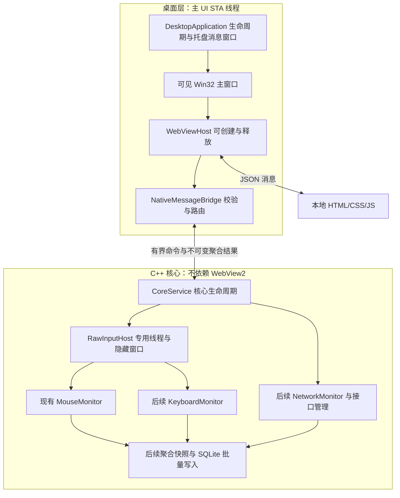

# WebView2 桌面集成：第一阶段检查与最小改动方案

> 历史第一阶段设计。桌面实现与测试已继续推进；以下“尚未实现”等状态只描述当时检查点，当前请参阅 development-status.md 和根目录 README。

日期：2026-11-04，Asia/Singapore。状态：**项目检查和架构设计已完成；桌面程序尚未实现**。

本轮按新需求先输出分析，不重建项目、不迁移现有目录、不修改已验证的鼠标采集算法，不继续开发完整可视化页面。此前中断的 HTTP 报告页原样保留为未完成工作。

## 1. 当前项目实况

| 区域 | 已有内容 | 可复用部分与缺口 |
| --- | --- | --- |
| 构建 | CMake 3.24+，C++20；库 `mouse_core`、`raw_input`；五个可执行目标 | 本次 LLVM-MinGW Release 完整构建成功；WebView2 尚无 SDK 查找、链接或复制规则 |
| MouseMonitor | 五键、时间双击、精密滚轮、固定容量分钟桶与查询 | 直接复用，不因 UI 引入而重写；不是标准空间双击 |
| RawInputHost | 独立隐藏窗口、`GetMessage`、统一鼠标/可选键盘注册、内存计数、资源指标 | 已不依赖可见窗口，但当前 `run()` 阻塞调用者，需由桌面核心服务在专用线程上创建和运行 |
| KeyboardMonitor | 仅 Raw Input 里的键盘总 DOWN 验证计数 | 没有生产按键分布、热力图、排除上下文或独立模块 |
| NetworkMonitor / NetworkInterfaceManager | 技术设计文档 | 尚无实现；没有经过验证的 IPv4/IPv6 分项计量 |
| SQLite / 配置管理 | 持久化与 API 设计文档 | 无数据库依赖、数据库文件、迁移或 DatabaseManager；当前是会话结束后写 JSON |
| Web | `web/index.html`、`web/styles.css` | 可复用样式和布局片段；HTML 引用的 `web/app.js` 不存在，没有可工作的数据绑定或图表组件 |
| HTTP | `src/mouse_dashboard.cpp`，只读 `GET /api/reports` 与 `GET /api/report?name=...` | 是未完成报告工具，非监测产品 API；本轮编译成功，但没有启动服务或验证页面功能 |
| 桌面窗口 / 托盘 / 自启动 | 无 | 需要新增桌面层，不能把测试用 `mouse_latency_target` 当作应用主窗口 |
| Git | 源码、文档目前显示为未跟踪文件 | 保留当前内容，不执行 reset、clean、覆盖或未经请求的提交 |

实际存在的目录保持 `include/pulsetrace`、`src`、`tests`、`tools`、`docs`、`web`、`build`；仅给新增桌面模块增加子目录，无须为匹配示例目录而搬迁 MouseMonitor。

现有 HTTP 默认端口此前检测到被百度输入法占用。桌面版本不依赖 8765，也不终止其他程序来抢占端口。

### 本机依赖检查

- 系统：此前实测 Windows 11 Pro 10.0.26300；Windows 10 兼容性尚未测试。
- 可用工具链：`build/tools/llvm-mingw-20260616-ucrt-x86_64`，Clang 22.1.8；CMake 3.31.8。
- 当前 PATH 和已检查的 Visual Studio 目录中未找到可用 `cl.exe`；不能声称 MSVC 构建已通过。
- 已发现 `C:\Program Files (x86)\Microsoft\EdgeWebView\Application\156.0.4314.58\msedgewebview2.exe`，文件版本为 156.0.4314.58。这是 Runtime 文件存在的证据，还不是 Loader 检测或环境初始化成功的证据。
- 工作区没有 `WebView2.h`、WebView2Loader 或已配置的 SDK。LLVM-MinGW 含 `wrl.h`，但其中 `wrl/implements.h` 未启用；不能直接假定官方示例里的 WRL `Callback` 可用。
- 已只读查询官方 NuGet 版本索引，确认稳定版 `Microsoft.Web.WebView2 1.0.4314.35` 可获取；本轮没有下载或安装该 SDK。

## 2. SDK 与 CMake 接入决策

使用固定版本的 Release SDK `Microsoft.Web.WebView2 1.0.4314.35`，保存在 `build/deps`，记录包来源、哈希与许可证。SDK 是构建依赖，不是完整浏览器；运行时优先使用系统 Evergreen Runtime，缺失时由原生窗口明确提示，不静默安装或捆绑完整 Chromium。依据 [官方 Win32 入门](https://learn.microsoft.com/en-us/microsoft-edge/webview2/get-started/win32) 与 [运行时分发说明](https://learn.microsoft.com/en-us/microsoft-edge/webview2/concepts/distribution)。

新增独立 `PulseTrace` 可执行目标，由 `PULSETRACE_BUILD_DESKTOP` 开关控制，默认不影响既有验证程序。新增 `cmake/FindWebView2.cmake`，接受明确的 `WEBVIEW2_SDK_ROOT`；缺失 SDK 时只对已启用的桌面目标报可操作错误，不在 configure 阶段静默联网下载。

初步选择 x64 `WebView2Loader.dll` 随桌面 exe 部署：按 exe 绝对目录安全加载 DLL，显式获取官方导出函数，避免把 MinGW 与 MSVC 静态库兼容性当作既成事实。MSVC 后续可评估 `WebView2LoaderStatic.lib`，但第一版只维护一条经实际验证的加载路径。

第二阶段先做三项编译探针：SDK 头文件、最小 COM completion handler、Loader 导出调用。优先复用当前 LLVM-MinGW，不以复杂的 WRL/WIL 依赖作为前提；若失败，再定位具体不兼容项，使用 MSVC + Windows SDK 作为可靠的官方示例构建路径。不能因现有核心使用 Clang 就宣称 WebView2 已兼容该工具链。

计划的桌面构建命令（**目标尚未实现，当前不可直接运行**）：

```powershell
cmake -S . -B build/desktop-msvc -A x64 `
  -DPULSETRACE_BUILD_DESKTOP=ON `
  -DWEBVIEW2_SDK_ROOT="D:/path/to/Microsoft.Web.WebView2.1.0.4314.35"
cmake --build build/desktop-msvc --config Release --target PulseTrace
```

SDK/Loader 支持与 Runtime 版本独立核验：使用 `GetAvailableCoreWebView2BrowserVersionString` 检测可用运行时，检查环境/控制器创建返回值；较新接口通过 `QueryInterface` 探测能力，失败时明确降级或报错。不要硬编码本机的 Runtime 版本目录。接口依据 [WebView2 Globals](https://learn.microsoft.com/en-us/microsoft-edge/webview2/reference/win32/webview2-idl)。

## 3. 三层与线程边界



主线程调用 `CoInitializeEx(..., COINIT_APARTMENTTHREADED)`，保留 Win32 消息循环。所有 WebView2 API 和 COM 资源创建/销毁都在该线程；不把 WebView2 指针传给采集或数据库线程。官方明确要求 UI STA 和消息泵，见 [WebView2 threading model](https://learn.microsoft.com/en-us/microsoft-edge/webview2/concepts/threading-model)。

CoreService 在自己的输入线程内创建、运行和销毁 RawInputHost，确保 HWND 的线程归属不变；该线程接收 Raw Input，不受主窗口隐藏、销毁 WebView2 或页面重载影响。

对现有 RawInputHost 只做必要的生命周期扩展：

- 保留现有定时验证运行方式，另提供服务运行方式、启动就绪/失败通知和线程安全 `request_stop()`。
- 通过向其隐藏窗口发送专用消息停止；不能把该 `WM_CLOSE` 与主窗口“隐藏到托盘”动作混用。
- 在所属线程中执行开始/暂停和按需聚合快照；暂停时清理双击状态，标记覆盖缺口。
- UI 不能跨线程读取当前 `mouse()` / `metrics()` 返回的引用；这些对象当前没有同步保护。只传不可变聚合快照，不传原始输入、设备句柄、逐事件时间戳。
- 控制台退出处理器是目前探针的进程级全局状态，桌面版由 DesktopApplication 统一管理退出，不让多个宿主争抢该处理器。
- 不修改 `handle_raw()` 的计数口径或 MouseMonitor 状态机，除非独立测试证明存在缺陷。

数据库线程是第四阶段的新增项。第二/三阶段先用原子心跳和受控的内存鼠标汇总验证生命周期，不声称已经后台写 SQLite。网络所需权限未来隔离处理，不因此让 WebView2 主进程默认以管理员运行。

## 4. 窗口、托盘与 WebView2 生命周期

采用原生窗口边框，支持系统拖动、最小化/最大化/缩放，使用 Per-Monitor V2 DPI awareness；响应 `WM_SIZE`、`WM_DPICHANGED` 更新控制器 Bounds，最低尺寸以 DIP 换算。窗口位置/大小、主题和关闭行为最终由 ConfigurationManager 保存，恢复时夹到现有显示器工作区。

### 初始化状态机

`Uninitialized → CreatingEnvironment → CreatingController → Loading → Ready`

各异步回调携带 generation；关闭、退出或重建时 generation 失效，迟到回调不能访问已销毁 HWND。异步完成失败、Runtime 缺失、数据目录不可写、导航失败都显示原生可诊断状态，避免空白窗口和无界重试。

### 第三阶段关闭到托盘

1. 确认托盘图标已成功创建；失败时保持主窗口可见，避免用户失去控制入口。
2. 主窗口 `WM_CLOSE` 默认转为 HideToTray，不停止 CoreService。
3. 停止原生 UI 刷新任务和前端订阅，移除不再使用的 WebView2 事件处理器。
4. 显式调用 `ICoreWebView2Controller::Close()`，释放 controller/core 引用，而非只设置不可见。控制器关闭语义见 [ICoreWebView2Controller](https://learn.microsoft.com/en-us/microsoft-edge/webview2/reference/win32/icorewebview2controller)。
5. 生命周期观察器暂留 environment 的进程退出事件注册，等待 `BrowserProcessExited` 后注销并释放最后引用；避免捕获强引用形成 COM 事件循环。
6. 主线程继续处理托盘、异步清理和退出消息；输入线程继续接收并聚合 Raw Input。

BrowserProcessExited 与 ProcessFailed 到达顺序不能假设固定；前者通知进程组资源结束，后者处理异常。恢复与关闭统一进入状态机，依据 [进程事件文档](https://learn.microsoft.com/en-us/microsoft-edge/webview2/concepts/process-related-events)。

资源释放过程中再次打开窗口，先显示原生加载状态，将单个重开请求排队，异步等待对应进程组结束后重建。观察超时要保留诊断信息和明确失败状态，不阻塞 STA、不无限等待，也不批量结束系统中所有 msedgewebview2.exe。重新打开后重新查询核心/数据库，不依赖旧页面的 JavaScript 内存。

### 暂时最小化

普通最小化可先暂停 UI 推送，按接口支持评估 TrySuspend/Resume；它属于短暂节能路径，不替代关闭到托盘时的控件释放，也不保证 Chromium 内存归零。相关 API 见 [ICoreWebView2_3](https://learn.microsoft.com/en-us/microsoft-edge/webview2/reference/win32/icorewebview2_3)。

### 完全退出

唯一退出状态 `Running → StoppingCapture → Flushing → StoppingWorkers → ClosingUI → Exited`；重复点击退出幂等。核心先拒绝新采集，输入线程生成最终聚合快照并确认停止；数据库线程完成事务、在所属线程关闭 SQLite 后退出；协调器确认后台线程结束，再释放 UI、删除托盘图标、销毁窗口并退出消息循环。等待过程用异步状态通知，避免 UI 同步 join 与工作线程等待 UI 形成死锁。

数据库写失败需提供明确的重试/丢弃退出选择；不能未经用户选择静默声称保存成功。第二阶段尚无数据库，仅验证 UI 资源释放；第三阶段完成托盘与核心连续性，第四阶段补齐正式 flush 协议。

托盘用 Shell_NotifyIcon，处理 Explorer 重启后的 TaskbarCreated；提供打开、开始、暂停、今日统计、设置、完全退出。自启动只通过显式设置启用，不在最小验证阶段自动配置。

## 5. 本地来源和消息协议

选择 `https://pulsetrace.example/` 映射到 exe/web，使用 `SetVirtualHostNameToFolderMapping(..., DENY)`；只映射只读前端资源，绝不把 data/monitor.db 或整个程序目录映射给页面。`.example` 用于避免真实站点冲突，依据 [虚拟主机名映射文档](https://learn.microsoft.com/en-us/microsoft-edge/webview2/reference/win32/icorewebview2_3)。

WebView2 用户数据目录显式指定为 exe/data/webview2，数据库、配置、轮转日志同样在 data。程序目录不可写时，由原生对话框让用户明确选择替代数据目录；未选择就报错退出或停留在诊断状态，不静默写入 AppData/临时目录。

NavigationStarting、FrameNavigationStarting、NewWindowRequested 限制来源；禁用不需要的 host objects、下载、权限请求和外部页面访问。每条 WebMessageReceived 都检查实际消息来源和当前页面来源，再执行结构校验。该做法依据 [Develop secure WebView2 apps](https://learn.microsoft.com/en-us/microsoft-edge/webview2/concepts/security)。

桌面版只维护 NativeMessageBridge：`chrome.webview.postMessage` → WebMessageReceived → 校验/服务路由 → PostWebMessageAsJson。保留现有 HTTP 报告工具作为独立可选验证目标，但桌面进程不启动它，不再开发功能重复的监测 HTTP API。

| 项目 | 原生消息 | 常驻本地 HTTP |
| --- | --- | --- |
| 传输与生命周期 | 依托 WebView2，UI 关闭后桥接停止 | 多一个监听服务、端口与启停关系 |
| 安全约束 | 来源、导航及消息白名单 | 额外 Host/Origin/CSRF、浏览器访问与端口冲突处理 |
| 浏览器访问 | 只供受信本地 UI | 可供独立浏览器，需要单独产品需求 |
| 性能结论 | 小消息、聚合结果，后续测量序列化/往返延迟 | 不能未经基准声称必然更慢或更快 |
| 本项目选择 | 桌面版主通道 | 不作为桌面运行依赖 |

协议示例：

```json
{
  "type": "get_status",
  "request_id": 1,
  "params": {}
}
```

```json
{
  "type": "response",
  "request_id": 1,
  "ok": true,
  "data": {"core_state": "running", "ui_state": "ready"},
  "error": null
}
```

失败返回同一 request_id、`ok:false` 与 `{code,message}`；无法解析请求 ID 时用 null。第二阶段仅实现 `ping` 与 `get_status`；后续按阶段开放 `get_statistics`、开始/暂停、有限配置更新。采用真正的 JSON 解析/序列化库，禁止字符串搜索代替参数验证，或把消息拼成 JavaScript/命令行。JSON 库在第二阶段固定版本并说明许可，本轮尚未引入。

限制消息大小（初始建议 64 KiB）、嵌套深度、请求 ID 类型/范围、参数字段白名单、时间范围与聚合粒度，拒绝重复/未知字段策略需固定。只允许明确命令，不提供任意文件路径读取、进程执行、SQL 或通用系统代理。异步结果回到 UI 线程再发消息；页面关闭时取消待返回 UI 请求，核心任务不持有 WebView2 引用。

## 6. 最小增量文件计划

以下为计划，不代表已创建或已实现：

| 新增/修改 | 职责与边界 |
| --- | --- |
| `cmake/FindWebView2.cmake` | 固定 SDK 定位与架构/Loader 校验 |
| `src/desktop/main.cpp` | COM STA、桌面入口和消息循环 |
| `include/pulsetrace/desktop/*`, `src/desktop/*` | DesktopApplication、WebViewHost、NativeMessageBridge；第三阶段增加 TrayIcon |
| `web/validation/index.html`、独立本地 JS/CSS | 只显示桥接握手、状态、错误和关闭/重开验证，复用现有样式；不先做六页完整图表 |
| `include/pulsetrace/core_service.hpp`、`src/core_service.cpp` | 第三阶段核心生命周期、输入线程启动/停止与快照投递 |
| `raw_input_host.hpp/.cpp` | 仅第三阶段加入服务退出、暂停和快照接口，不重写采集口径 |
| `CMakeLists.txt`、`tools/build.ps1` | 可选桌面目标，保留现有核心验证构建和测试 |
| 桌面 DPI manifest、资源文件 | 原生边框、DPI、程序/托盘图标 |
| `tests/desktop_lifecycle*`、资源测量脚本 | 初始化失败、迟到回调、反复重开、后台连续性与进程组测量 |

## 7. 实际检查结果与下一阶段准入

本轮运行：

```powershell
.\tools\build.ps1 -Toolchain PortableLLVM -Configuration Release
.\build\llvm-release\mouse_tests.exe
```

结果：现有全部目标构建成功，包括此前未构建的 mouse_dashboard；CTest 1/1 通过，测试程序报告 56 项检查通过、含 3,000,000 条重放样本。本次没有再次运行 60 秒基准、没有开始新的输入采集、没有启动报告 HTTP 服务，也没有创建 WebView2 或修改系统自启动。

本阶段只新增此设计文档并更新 README 状态说明；没有修改采集实现、现有 CMake、数据库或页面逻辑。之前回合留下的源码不因本阶段检查而被标记为正式可用。

第二阶段必须交付可实际编译的 Win32/WebView2 最小窗口：Runtime 检测、明确 UDF、本地虚拟来源、ping/get_status 双向 JSON、导航限制、尺寸/DPI、正常关闭与进程事件记录。缺 SDK、只读目录、异步初始化期间关闭、页面加载失败均需实测。

第三阶段在此基础上验证：托盘隐藏后 Raw Input 继续，反复重开不少于 20 次，初始化尚未完成就关闭/重开，Explorer 重启恢复图标，完全退出无死锁。真实 HID 测试使用独立已知输入源，不能将零包空闲测试或软件重放当作物理连续性证据。

资源采样至少覆盖“仅核心 / UI 打开 / 隐藏尚未退出 / 控制器释放后进程组退出 / 重新打开 / 长期后台”。记录主进程及本应用 WebView2 进程组的 CPU、Private Bytes、Working Set、线程、句柄与磁盘写入量；用环境的进程信息与进程创建时间识别 PID 复用，不把其他应用的 WebView2 算进来，不把工作集合计当作无共享物理内存。WebView2 是多进程模型，依据 [Process model](https://learn.microsoft.com/en-us/microsoft-edge/webview2/concepts/process-model)。

先订阅 BrowserProcessExited 并保留本应用进程组标识，再关闭控制器，观察退出和内存变化；不假设 Close 返回时内存立即归零。不启动额外 WebView 来测量已关闭 WebView，以免改变被测生命周期。若进程或内存未按预期释放，记录具体 PID、时间、引用和共享 UDF 状态，再定位，不伪造固定内存承诺。

SQLite、网络吞吐量、Clash TUN、真正键盘模块与完整界面留在对应阶段；此处仅给出接入边界，不声称这些功能已经完成。
